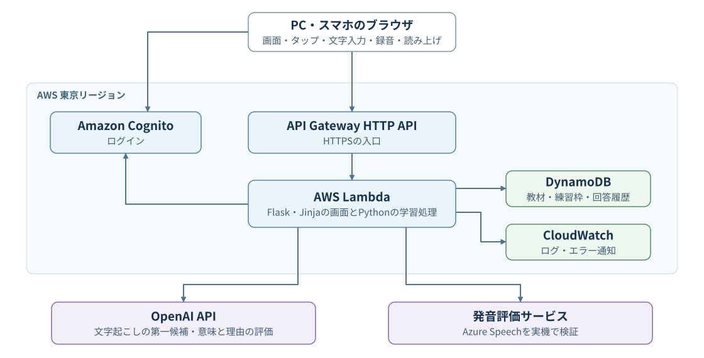
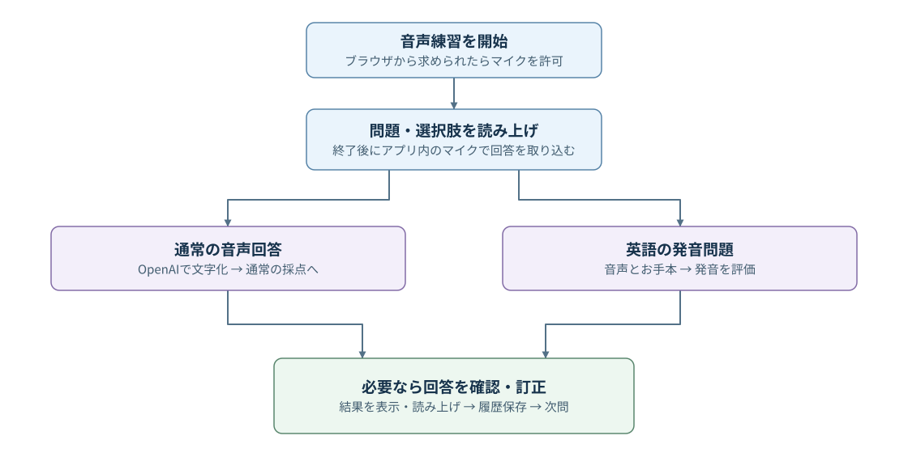

# 中学生向け一問一答アプリ 設計正本

2026年11月17日

PCとスマホのブラウザで同じ教材を練習し、同じ練習枠の履歴を参照できる専用Webアプリを作る。画面での練習に加え、音声で出題・回答できるようにする。採点の精度を優先し、その上で運用費と運用作業を抑える。

## 初版でできること

| 項目 | 動作 |
|---|---|
| 出題 | 問題を一問ずつ常に画面に表示する。音声出題をオンにすると、問題を読み上げる。4択では選択肢も番号付きで読む。 |
| 回答形式 | 問題ごとに4択か文字列入力を指定する。4択はクリック・タップ、文字列はキーボードで答える。 |
| 音声入力 | 音声出題とは独立して設定できる。4択では番号、短答では答えを話す。書き取りなど、問題による入力制限を優先する。 |
| 手書き | 端末の手書きキーボードから文字列入力欄に入力できるかを確認する。アプリ内の手書き欄は別途検討する。 |
| 学習者と履歴 | ログイン、学習者、練習枠を区別する。同じ学習者が「普段」「テスト前」などの練習枠を持てる。回答履歴は練習枠にひも付け、アクセス権のある端末から参照する。 |

## システム構成

| 部品 | 役割 |
|---|---|
| PC・スマホのブラウザ | 問題・結果・履歴を表示し、タップ・文字・音声を受け付ける。JavaScriptは読み上げ、マイク録音、音声入出力と画面・APIをつなぐ処理に使う。 |
| API Gateway HTTP API・Cognito | HTTPSの入口とログイン。サーバーがログインを検証し、学習者と練習枠へのアクセス権を確認する。 |
| AWS Lambda・Flask・Jinja | HTMLの生成とAPIの入口を提供する。出題・採点・履歴のロジックはPythonに置き、文字と音声で共通化する。画面と学習処理はコード上で分け、初版では同一URL・同一デプロイで提供する。 |
| DynamoDB | 学習者と練習枠、教材、問題、許容別解、採点基準、回答履歴を保存する。履歴には採点に使った回答文字列、判定と理由を残す。 |
| OpenAI API | 意味や理由の評価が必要な答案を採点基準に沿って評価する。通常の音声回答の文字起こしにも、実機検証後に使う想定。 |
| 発音評価サービス | お手本の語・文に対して、発音を音声から評価する。候補は検討メモに記載する。 |
| 構築・運用 | AWS東京リージョンを前提に、SAMでリソースを定義する。Lambda Web AdapterとECRを使って配備し、Secrets ManagerでAPIキーを管理する。CloudWatchで障害を確認し、DynamoDBのPITRで履歴の復元に備える。 |

## 音声回答の操作

利用者は問題アプリで「音声練習を開始」を押し、必要に応じてブラウザのマイク利用を許可する。読み上げが終わってからアプリが回答の音声を取り込む。録音と送信はアプリ内の処理で完結する。開始後は声だけで数問続けられることを目標とし、対象スマホで動作を確認する。

- **通常の音声回答** 音声を文字に変換し、文字入力と共通の採点に渡す。聞き違いが疑われるときは、認識した回答を表示または読み返し、確認・言い直しを受けてから結果を確定する。
- **英語の発音問題** 音声とお手本の語・文を発音評価に渡す。答えが伝わったかと、どの音を練習するとよいかを分けて返す。

## 採点ルール

| 判定 | 条件 |
|---|---|
| **○** | 必須の採点項目を満たす。意味が明確なら、模範解答と異なる言い方や、ぎこちない日本語も認める。表現の助言は判定と分ける。 |
| **△** | 必須項目の一部が正しい。結論は正しいが、問題が求めた理由が抜けている、または誤っている場合など。 |
| **×** | 採点対象の答えが誤っている。漢字の書き取りなど、表記そのものが目的の問題は所定の表記を評価する。 |
| **要確認** | 音声が不明瞭、または採点基準だけでは答案の意味を確定できない。確認までは誤答として集計しない。 |

4択の選択肢ID、数値、登録済みの別解はPythonで照合する。意味や理由の評価には、問題・本人の回答・採点基準をAIに渡す。AIは基準ごとの評価と根拠を返し、Pythonが判定を確定する。各問題には、何を評価するか、○に必要な要素、認める別解の例を記載する。

たとえば「反比例で x を2倍にすると y はどうなるか。理由も答える」なら、「半分になる。x と y をかけた数が同じだから」は○、「半分になる。和が一定だから」は△、「y も2倍」は×とする。

## 更新方法

検討結果は [検討・検証メモ](notes.md) に残す。方針が決まったら、正本と関係する図を同じコミットで更新する。図は1図1ファイルとし、Markdown表示にもdraw.ioでの編集にも同じファイルを使う。
